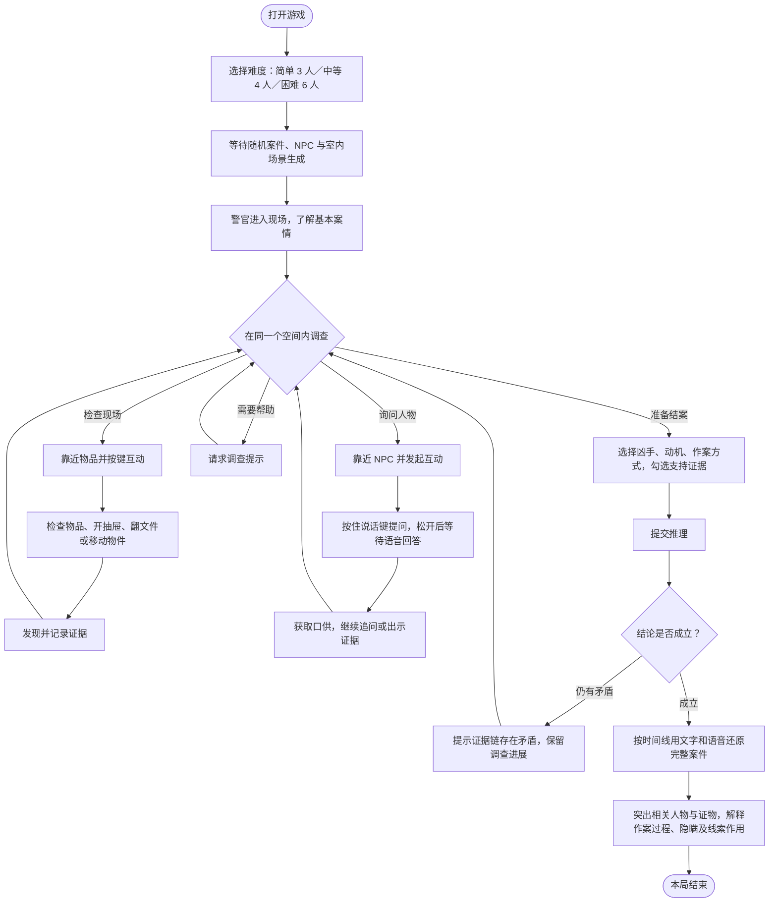
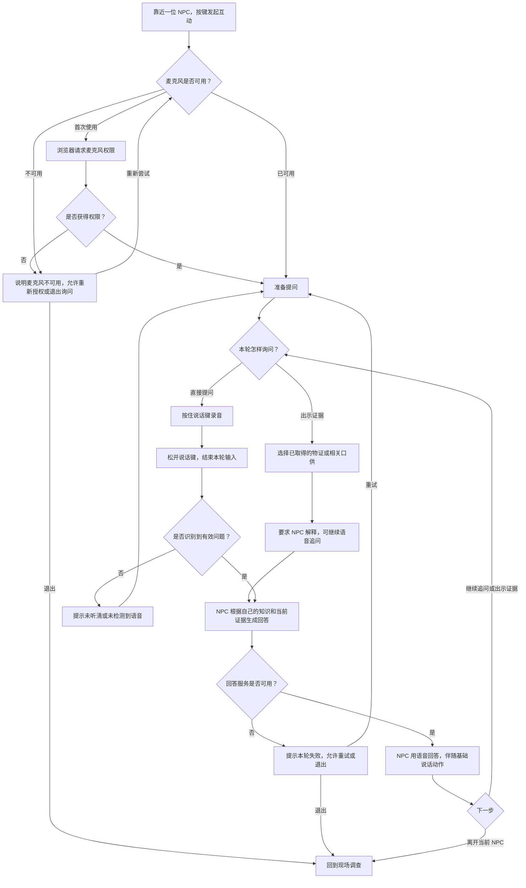

# AI 警官探案游戏 PRD

版本：v0.8 · TUNIC 主参考重做稿（狐狸警官／奇幻城镇）

整理日期：2026 年 10 月 24 日
验收时间：2026 年 10 月 24 日 13:30（北京时间）  
工作名称：夜班档案（正式名称待用户确认）

## 1. 文档用途与当前阶段

本 PRD 作为后续开发、测试和验收的依据，记录本次对话中已确认的需求，并提供实现这些体验所需的开发建议。

当前阶段为开发实施与本机验收。用户于 2026 年 10 月 24 日确认所有三类场景和三档难度都做轻量可玩版，并已提供 DeepSeek API Key 授权本机接入。本 PRD 继续作为开发依据；本机原型位于 `ai-detective-game/`，启动说明见其 README。此前被删除的临时游戏与本次新建的正式原型相互独立。

本文使用以下口径：

- **已确认需求**：用户在对话中明确选择或确认的产品要求，是核心验收依据。
- **开发建议**：为保证体验完整、逻辑稳定或成本可控而提出的方案，尚不能视作用户已确认的具体实现。
- **待确定事项**：需要参考分析、技术选型或进一步沟通才能落定的细节。

## 2. 产品定义

### 2.1 项目目标

开发一款用于 AI 产品经理面试展示的单人探案游戏。玩家以狐狸警官身份，在奇幻城镇的一处室内案发空间中搜证并与 NPC 交谈，整合分散的信息，找出凶手，最后通过完整案情复盘理解案件经过。

AI 是游戏核心体验的一部分：参与案件、人物及相关内容的生成，并支持玩家自由询问 NPC。不能把固定脚本对话当作真实 AI 接入的完成结果。

### 2.2 核心体验

> 作为警官进入一处陌生的案发现场，观察空间、检查物品、逐个询问在场者，用证据核对口供，再提交自己的破案结论。

玩家发现的信息来自两类渠道：现场物证与人物口供。每个 NPC 只掌握部分信息，凶手就在本局在场的 NPC 之中；无辜者也可能因为自己的秘密隐瞒或撒谎。

### 2.3 展示价值

面试展示需要能够说明以下产品问题，具体评估方式属于开发建议：

- 自由对话怎样推进调查，而不是成为与案件无关的聊天。
- 随机内容怎样形成相互对应、可以推理的案件。
- NPC 的局部知识、隐瞒与谎言怎样影响玩家判断。
- 语音交互、生成等待、异常处理和调用成本怎样共同影响体验。

## 3. 已确认的首版范围

### 3.1 角色、镜头与操作

- 玩家角色为**狐狸警官**，模型轮廓、比例、服装和动作以 TUNIC 狐狸为直接参照。
- 使用**第三人称斜上方视角**，能看见警官、NPC 和现场陈设。
- 使用 **WASD** 控制警官移动。
- 靠近人物或物品后，通过按键互动。
- 首版默认使用固定斜上方视角；WASD／方向键移动，点击地面移动，E 互动，V 按住说话。该交互方案已用于原型，后续可按试玩反馈调整。

### 3.2 场景

- 故事背景改为**奇幻城镇**。这是用户最新确认，覆盖此前的现代中国背景。仍使用中文人物名、对白和案情。
- 三类单室内场景对应调整为：**林间宅邸会客厅、档案塔书房、古桥旅店会客厅**，保留宅邸／办公书房／旅店的功能分类。
- 这些是不同的案发场景类别，不是同一局需要前往的三个房间。
- **每局全部调查在同一个室内空间中完成**，不需要前往其他空间。
- 每局重新生成建筑／室内布局和场景背景，复杂度可以控制。
- 不能仅通过替换案名、人物名或文字描述，宣称完成场景随机生成。
- 首版完成后可继续新增场景类别；未来新增场景仍遵守每局只在一个室内空间中调查的约束。

### 3.3 人物与对话

- 简单难度为 **3 位 NPC**，中等为 **4 位 NPC**，困难为 **6 位 NPC**。
- 上述人数指可询问的在场人物，警官和死者另算。
- 凶手属于当局 NPC，不得在结尾突然引入一个未登场人物作为凶手。
- 每个 NPC 只掌握案件的一部分信息。
- 无辜者也可能为私人秘密隐瞒或撒谎。
- NPC 为人类镇民，外观直接参考 Escape Simulator 人物模型与服装部件；主要留在各自位置，有待机、转身和说话反馈。
- 玩家**按住说话键提问，松开后等待 NPC 回答**。
- NPC 使用**语音回答**。

### 3.4 搜证与质询

- 可检查现场物品。
- 可开抽屉、翻看文件、移动部分物件，从中发现证据。
- 可以向 NPC 出示物证或相关口供，要求其解释。
- 搜证与询问都应参与破案过程。

### 3.5 结案与复盘

- 玩家通过点选／勾选表单提交结论，不要求用语音向系统汇报。
- 提交内容包括：**凶手、动机、作案方式、支持证据**。
- 指认错误后可以继续调查。
- 错误反馈提示证据链仍有矛盾，不在此时完整揭晓答案。
- 正确结案后，按时间顺序还原案件故事。
- 复盘采用**文字＋语音**，并突出相关人物和证物。
- 复盘解释作案经过、每个人隐瞒的内容以及关键线索的作用。
- 当前未要求完整的三维动画重演或电影式演出。

### 3.6 难度、运行与预算

- 简单：**3 位 NPC，目标体验时长 5–8 分钟**。
- 中等：**4 位 NPC，目标体验时长 10–15 分钟**。
- 困难：**6 位 NPC，目标体验时长 15–20 分钟**。
- 游戏有提示功能。
- 在用户自己的电脑浏览器中运行和验收。
- 用户已提供 DeepSeek API Key，首版使用 `deepseek-flash`；密钥保存在本机服务端配置。
- 模型 API 预算为 **20–30 元人民币**。

上述时长是体验设计目标，并未确认使用倒计时、超时失败或按时间扣分。

## 4. 一局游戏的完整流程

### 4.0 用户主流程图

搜证、询问和出示证据可以反复交替，玩家不必按固定顺序完成。请求提示与提交结论都是调查中的可选操作。

主流程约束：

- 场景类型为居民客厅、办公室或旅馆会客厅；一局中不切换到其他调查空间。
- 人数为可询问 NPC 数量，警官和死者另算。
- 玩家可以搜证后询问，也可以先询问再回到现场物品核查。
- 无辜者也可能隐瞒或撒谎，因此获得口供不等于已经证实口供内容。
- 提交错误结论后回到同一局继续调查，不重新生成案件，也不清空既有进展。
- 完整答案在正确结案后的复盘中解释。

### 4.1 开始调查

1. 玩家选择简单、中等或困难。
2. 系统生成当局场景、案件与人物。
3. 对案件和场景执行必要检查，完成后才允许玩家进入。
4. 玩家以警官身份出现在案发空间，获得基本案情和调查目标。

步骤 3 为开发建议：避免让不完整、互相矛盾或无法交互的内容进入可玩状态。

### 4.2 调查现场

1. 玩家控制警官在当前空间内移动。
2. 靠近物品时能识别可执行的互动。
3. 检查、开启、翻阅或移动关键物品，发现并记录证据。
4. 玩家可以再次查看已经发现的证据。

证据记录、回看入口的具体 UI 属于开发建议，目的在于支持后续出示与勾选提交。

### 4.3 询问人物

1. 玩家接近一位 NPC，发起询问。
2. 按住说话键提问，松开后提交本轮问题。
3. NPC 根据自己的身份、见闻及可披露内容，用语音回答。
4. 玩家可以继续追问，或选择物证／相关口供要求解释。
5. 玩家发现新信息后，可返回当前空间继续搜证，再询问其他人。

### 4.4 提交推理

1. 玩家打开结案界面。
2. 选择凶手、动机与作案方式。
3. 勾选支持结论的证据。
4. 系统判定结论是否成立。
5. 若仍有矛盾，玩家回到当前调查，已经获得的进展继续保留。
6. 若结论成立，进入案件复盘。

### 4.5 还原案件故事

1. 按时间顺序说明案件发生前后的关键行动。
2. 用文字和语音解释凶手的动机与作案过程。
3. 在叙述相关内容时，突出对应 NPC 与证物。
4. 解释无辜者的秘密或谎言，说明为什么看起来可疑。
5. 说明证据怎样相互验证，并回顾玩家的推理。

不应在复盘中凭空添加玩家调查阶段无法接触到、却决定案件答案的核心事实。

### 4.6 语音询问与证据质询流程图

下图的按住说话、NPC 语音回答和出示证据为已确认体验；麦克风授权失败、识别失败和服务异常的恢复分支为开发建议，与第 8 节保持一致。

补充说明：

- 开发建议：出示证据本身可以发起一次解释请求，不要求玩家每次重复说出证据的名称。
- 是否记录字幕、显示识别结果、提供文字输入兜底和播放控制仍属于待确定的 UI 细节。
- 服务异常不能伪装成角色撒谎、沉默或规则口供；玩家需要知道本轮询问未正常完成。
- 案件生成阶段如失败，建议提示失败并允许重新生成或返回难度选择；不能进入缺失人物或关键证据的现场。

## 5. 场景、人物与视觉要求

### 5.1 主要与辅助参考（最新确认）

**TUNIC 为整体设计标准，Escape Simulator 为辅助标准。** 不能再将参考范围缩减为镜头或少数交互机制。

- TUNIC：角色比例与轮廓、建筑和家具的网格形态、材质配色、光影、镜头、标题构图、菜单层级及游戏内视觉组织。狐狸就是警官，奇幻建筑可以沿用。
- Escape Simulator：人类 NPC 外观，室内陈设密度与摆放，可交互部件、开柜、抽屉滑轨、拿取、背包、旋转检查。
- 标题页已对照实际 TUNIC 主菜单截图：左侧发光长剑，右侧标题与纵向菜单。不得凭空另做一个与参考无关的封面。
- 本机重做版本使用用户已安装游戏和已归档 REA 资料中的狐狸、标题长剑、石拱门、桌凳、宝箱及人类人物部件；茶杯、纸张、铜钥匙和瓶子也从 Escape Simulator 归档几何导入。转换记录与来源见 `ai-detective-game/public/assets/reference/manifest.json`。
- 当前是针对本机探案玩法的资源组合与交互重建，没有恢复原作者的完整源代码或工程；静态数据、实际浏览器观察与尚未验证的内容分别记录。

此前《小小梦魇》的主要风格方向由本次用户明确选择覆盖；其历史记录保留在旧版 PRD，不再用于当前重做的视觉决策。

### 5.2 单空间的构成

开发建议：每局空间应容纳警官、死者、对应难度的人物，以及足够的证据和互动点。通过家具分区形成不同观察角度，但不新增跨房间调查流程。

空间至少需要满足：

- 警官可以到达每位 NPC 和关键互动点。
- 可打开的抽屉、可翻阅的文件与可移动的物件可以被正常操作。
- 人物、家具和证物不发生影响调查的穿插或遮挡。
- 镜头能支持搜证，不应把关键证物长期藏在不可观察的墙体或家具后方。
- 六人难度下仍能辨认各个人物并到达其位置。

### 5.3 每局场景变化

已确认的体验结果是：每局布局和场景背景重新生成。

以下实现方式尚未选定：模块化三维资源组合、规则生成、AI 生成布局描述、AI 生成部分资源，或以上方式结合。

用户没有要求每局重新生成所有三维网格、贴图与人物模型；同时，也没有同意只使用固定布局和静态背景来替代场景生成。技术方案需要证明它能满足实际的空间与视觉变化。

开发建议：为场景类别保留可扩展的定义与资源组织方式，使首版后新增场景时能够复用调查流程；具体技术实现方式尚未选定。

### 5.4 人物表现

已确认 NPC 主要留在各自位置，并支持待机、转身和说话动作。

开发建议：询问时 NPC 朝向警官，通过简单身体动作表现回答状态。精细口型同步、复杂面部表情、全室自主寻路与群体反应不作为已确认范围。

警官确定使用 TUNIC 狐狸形象；NPC 使用 Escape Simulator 的男女头部、服装、发型和骨骼部件组成，维持人类镇民身份。美术与世界背景均采用奇幻方向，不再以现代中国制服与写实房间为基准。

## 6. 案件与 AI 的行为规则

本节是为保证用户期望的推理体验而提出的**开发建议**。它规定应当保证的结果，不代表已经选定某一种技术架构。

### 6.1 案件生成

建议先形成一份完整案件，包括：受害者、凶手、动机、作案方式、行动时间线、现场物证、人物关系，以及每位 NPC 的知识与隐瞒。

通过检查后固定为本局真相。玩家的提问、追问或错误指认不得随意改写已经发生的事实。

AI 应参与真实的案件与人物内容生成，不能仅为固定案件换标题或增加氛围描述后，就宣称完成随机案件生成。

### 6.2 NPC 的局部知识

建议为每位 NPC 明确记录：

- 自己亲历、听到或明确知道的内容。
- 对其他人的猜测及其依据。
- 不知道的事情。
- 不愿主动披露的秘密。
- 会说出的谎言及说谎原因。
- 出示什么证据或追问到什么程度后，会披露或更正哪些内容。

回答时必须区分“知道”“猜测”和“不知道”。某人不应因为系统拥有完整案件，就自动知道其他所有人的经历。

### 6.3 谎言与改口

无辜者可以撒谎，但应有与人物相关的原因。凶手的谎言应有可通过调查发现的破绽。

开发建议：改口对应明确条件，例如证物与其口供冲突，或者另一份口供否定其说法。改口后保留原口供，玩家可以看出变化发生在哪里。

随机回答互相矛盾不应被当成人物故意撒谎；系统需要能够区分设计中的谎言和生成错误。

### 6.4 自由表达与案件事实

AI 可以改变措辞、语气与情绪表达，但不得自行增加决定案件答案的新人物、新目击、新证物或新行动。

玩家可以用不同方式提问。面对与案件无关的问题，NPC 可以自然回应或引回调查，但这些交流不应意外改写核心事实。

提示与结案判定应以本局固定事实为依据，不能让模型在每次提交时重新决定凶手是谁。

### 6.5 案件可解性

开发建议在进入现场前检查：

- 证据、人物行动和时间线不相互冲突。
- 决定答案的关键证物与口供在本局可获取。
- 凶手属于本局人物，且不存在同样符合全部关键证据的另一位凶手。
- 无需读心、猜开发者意图或依赖复盘首次公开的关键事实才能破案。
- 不存在“必须先结案才能取得证据”等循环依赖。

生成失败时应明确告知并允许重试。固定演练案件不属于已确认的必做功能；如未来增加，必须明确区分真实 AI 案件与演练内容。

## 7. 搜证、口供与证据质询

### 7.1 物品互动

已确认支持检查物品、开抽屉、翻看文件、移动部分物件。

开发建议：只对有调查价值的物品提供较深互动，其他陈设主要承担环境表现。不要把“移动部分物件”扩展为房间内一切物体都必须参与完整物理模拟。

靠近互动点时，应让玩家能够识别互动对象与可执行操作。具体高亮、提示文字和互动键在 UI 设计中确定。

### 7.2 证据记录

开发建议为每条证据保留：名称、来源位置、发现方式、可观察内容、相关人物和获取状态。

人物口供应保留说话者与上下文。摘要可以帮助回看，但不得把 AI 推测写成已经证实的事实，也不应提前替玩家指认凶手。

### 7.3 出示证据

玩家可以选择已取得的物证或相关口供，向当前询问的 NPC 出示。

系统需要区分当前出示的对象与普通提问，让 NPC 知道玩家要求解释什么。结果可以是解释、否认、隐瞒、改口或承认部分行为，不应一律变成直接供认。

玩家尚未取得的证据不应出现在可出示或可提交的列表中。

## 8. 语音交互

### 8.1 已确认流程

选定询问对象 → 按住说话键 → 玩家说出问题 → 松开结束录音 → 系统处理 → NPC 语音回答。

持续开启麦克风并自动判断轮次不是当前确认的方式。

### 8.2 完整接入要求

语音体验包含语音识别、NPC 回答生成和语音合成三个部分。只接通文字模型不算完成该需求。

首版使用 `deepseek-flash` 处理案件与对话；玩家语音识别和 NPC 语音合成使用浏览器能力，不另购语音 API。不能默认语音识别在所有系统上离线可用。

### 8.3 交互与异常处理建议

- 清楚显示等待说话、录音中、处理中、NPC 回答中和失败等状态。
- 询问对象应明确，避免把问题发给附近的另一人。
- 未说话、误触或识别失败时，不生成无意义的 NPC 回答。
- 麦克风未授权、设备不可用或服务失败时，说明实际问题并允许重试。
- 避免将 NPC 播放的声音再次识别为玩家提问。
- 限制重复提交同一轮问题，避免重复调用和叠加播放。
- 对话和复盘的声音不应同时争抢播放。

同步字幕、识别结果确认、文字输入兜底、语音重播与取消播放都是开发建议，尚未成为用户明确确认的首版必做项。

## 9. 三档难度与提示

### 9.1 简单

已确认：3 位 NPC，5–8 分钟目标体验。

设计建议：关键线索更直接，人物关系与口供交叉较少，提示更明确。仍需同时使用搜证与询问完成推理。

### 9.2 中等

已确认：4 位 NPC，10–15 分钟目标体验。

设计建议：需要把数条物证和口供交叉核对，存在有合理解释的隐瞒与干扰信息。

### 9.3 困难

已确认：6 位 NPC，15–20 分钟目标体验。

设计建议：更多人物关系与信息交叉，需要更完整的证据链排除表面嫌疑，提示保留更多思考空间。

困难不应通过降低语音识别质量、增加等待、让 NPC 无依据地拒答或让场景无法观察来实现。

### 9.4 提示原则

已确认有提示功能。开发建议让提示基于玩家当前进度，优先指出调查方向或尚未验证的关系，再逐步给出更具体的建议。

各难度的物证数量、提示次数、提示冷却、评分和重复指认限制尚未确定，需要结合案件设计与试玩校准。不能把原型调试值自动升级为用户要求。

## 10. 结案与故事还原

### 10.1 提交内容

通过可点选／勾选的表单表达：

- 谁是凶手。
- 作案动机是什么。
- 使用什么方式作案。
- 哪些已获得的证据支持上述判断。

开发建议：凶手、动机和方式分别单选，支持证据多选。选项与本局内容对应，不能用固定且明显泄露答案的文字替代推理。

### 10.2 错误结论

已确认：允许继续调查，反馈证据链仍有矛盾，完整答案留到结案复盘。

错误提交不应清空当局已经获得的证据和对话。具体重试上限、是否扣分或是否允许主动认输未确认。

### 10.3 正确结案后的复盘

已确认采用时间线＋文字＋语音，并突出相关人物和证物。

复盘需要能回答：

- 案发前发生了什么，凶手为什么产生动机。
- 凶手何时、如何行动。
- 其他人在什么位置、看见了什么，以及隐瞒了什么。
- 哪些口供是真话，哪些是谎言或误解。
- 哪些证据共同锁定了凶手。
- 玩家的结论得到哪些证据支持，调查中有哪些重要信息遗漏。

开发建议通过镜头关注、人物标记或证物高亮突出对应对象，具体表现方式待视觉设计。完整三维剧情重演、专业配音剧和导出报告不在已确认范围内。

## 11. 运行、费用与数据

### 11.1 运行边界

已确认在用户本机浏览器运行和验收。目前没有公网部署、多人联网、登录账户或会员系统的需求。

本机服务、引擎、渲染技术和资源格式尚未选定。需要验证用户实际电脑与浏览器对场景、角色、语音录制和声音播放的支持。

### 11.2 API 预算

已确认 DeepSeek 已充值，模型 API 预算为 20–30 元人民币。

用户确认语音服务可产生额外费用，额外预算上限 **10 元人民币**。首版选择浏览器 Web Speech API 语音识别与 SpeechSynthesis 播报，不额外购买语音 API；语音识别可能使用浏览器厂商在线服务，仍需在用户 Chrome/macOS 上实测。

开发建议：

- 区分案件生成、NPC 对话、语音识别、语音合成与复盘的费用。
- 根据服务实际返回的用量记录成本，估算与官方账单分开标识。
- 避免因重播已生成的语音而重复付费生成。
- 为失败重试、重复请求和长对话设置合理限制。
- 如果需要超出已确认预算或引入额外付费服务，先明确说明。

### 11.3 密钥与调查数据

开发建议通过本机配置接入密钥，不将密钥写入前端代码、公开仓库或游戏存档。

完整案件真相、NPC 私有知识与玩家已获得的信息应分开管理，避免开局即向界面交付完整答案。

自动存档、跨次启动继续调查、历史案件列表与数据导出尚未明确确认，不作为当前必做范围。

## 12. 功能验收清单

以下验收项对应已确认体验。必要的逻辑和异常处理建议应在开发方案中明确如何验证。

### A01 · 角色、镜头与移动

进入游戏后能看见警官角色，镜头为第三人称斜上方；WASD 可控制移动，靠近物品和人物后可按键互动。

### A02 · 单一室内空间

居民客厅、办公室与旅馆会客厅作为不同场景类型可被选用；每局全部调查在同一个空间内完成，不要求切换到其他房间。

### A03 · 场景随机变化

多次开启案件时，能够观察到室内布局与环境背景的重新生成。仅改变文案或人物姓名不能通过该项验收。

开发建议使用不同生成种子抽样检查：人物和关键证据都可到达，互动可用，布局不会堵住调查路径。

### A04 · 难度与 NPC 数量

简单、中等、困难分别出现 3、4、6 位可询问 NPC，警官和死者不计入该人数。凶手属于本局人物。

### A05 · 搜证操作

能够完成检查物品、开抽屉、翻文件及移动部分物件的操作，并从其中发现案件相关证据。

### A06 · 按住说话

玩家面对明确的 NPC，按住说话键提问，松开后结束本轮输入，NPC 能以语音回答。不能仅用文字回答代替完成语音需求。

### A07 · 真实 AI 对话

接入真实服务后，玩家可以用不同措辞追问人物；回答与当前 NPC 的身份和案件信息有关。未配置或调用失败时，不能将固定回复伪装成模型回答。

### A08 · 分散信息与隐瞒

调查中能够体现不同人物知道不同内容；无辜者可因私人原因隐瞒或撒谎，玩家需要结合其他渠道核查。

开发建议对不同问法、重复询问和出示证据前后分别检查，区分设计中的谎言与模型生成错误。

### A09 · 出示证据

玩家可向 NPC 出示已取得的物证或相关口供；NPC 的解释能够围绕当前出示内容展开。

### A10 · 人物动作

NPC 主要留在各自位置，具备待机、转身和说话动作，不要求在室内自主巡游。

### A11 · 提示

玩家卡住时有可用的提示入口。提示能够帮助继续调查，具体力度与次数待难度设计确定。

### A12 · 勾选提交

玩家能通过表单选择凶手、动机、作案方式，并勾选已取得的支持证据，完成结案提交。

### A13 · 错误后继续调查

提交有矛盾的结论后，系统给出相应反馈，玩家仍可继续搜证和询问，已有调查进展保留。

### A14 · 完整案件故事

正确结案后，按时间线配文字和语音还原案情，突出相关人物与证物，解释作案经过、各人的隐瞒及证据的作用。

### A15 · 本机浏览器运行

在用户实际电脑的浏览器完成从开始、调查、语音询问、出示证据、提交结论到案件复盘的流程。

### A16 · 体验时长

通过真人试玩评估简单 5–8 分钟、中等 10–15 分钟、困难 15–20 分钟的目标。不能仅通过界面显示这些数字，就宣称体验时长已达标。

## 13. 开发期仍待确认或验证的事项

核心玩法已对齐，用户已同意开始实现。以下事项由实现默认值或后续试玩验证处理，不阻挡本机原型交付：

1. 正式游戏名称尚未最终确认；狐狸警官、奇幻建筑与人类 NPC 的外观方向已确认。
2. 按 TUNIC 主参考、Escape Simulator 辅助参考验收实际画面与交互；尸体表现保持非血腥。
3. 场景布局和背景的生成方式，以及需要达到的变化程度。
4. 实施采用 Three.js WebGL 2 与 Node 本机服务；第三人称斜俯视 3D 视图，WASD／方向键移动、点击地面或目标靠近、E 互动、V 语音输入。
5. DeepSeek 使用 deepseek-flash；浏览器 Web Speech API 与 SpeechSynthesis 为首版语音方案。
6. 案件真相校验、NPC 知识边界、谎言触发与结案判定的具体规则。
7. 三档难度的证据规模、提示策略，以及是否加入评分或重试限制。
8. 已加入对话字幕和文字输入兜底；语音识别结果不设二次确认；跨次存档未纳入首版。
9. 待用户在自己的 Chrome/macOS 上验证麦克风权限、识别可用性与实际语音往返耗时；当前只在 Chromium 自动化预览中检查了页面与文字对话。

## 14. 本次重做的参考来源

- [TUNIC](https://store.steampowered.com/app/553420/TUNIC/)：主要标准，包含角色、建筑、家具、材质、灯光、镜头与主菜单。静态 REA 索引：`research/tunic/index.json`、`research/tunic/extended/资料使用索引.txt`。
- [Escape Simulator](https://store.steampowered.com/app/1435790/Escape_Simulator/)：辅助标准，包含 NPC 外观、室内密度、部件开合、滑轨、拿取和物品检查。静态 REA 索引：`research/escape-simulator/资料使用索引.txt`，人物补充目录：`research/escape-simulator/characters/`。
- TUNIC 实际标题画面对照：[主菜单截图](https://www.mobygames.com/game/181370/tunic/screenshots/windows/1091075/)。该截图用作构图对照，并未作为游戏背景贴图。

此次开发不再引入其他作品作为新的美术方向。资源转换脚本在 `ai-detective-game/scripts/`，可追溯源对象、网格、UV、骨骼权重、绑定矩阵和所选纹理。

## 15. 后续交接

本 PRD v0.8 记录用户已授权按两款参考游戏全面重做。原型优先覆盖一条真实可运行的核心流程：

选择难度 → 生成场景与案件 → 警官移动搜证 → 按住说话询问 → 出示证据 → 勾选提交 → 错误时继续调查／正确时故事复盘。

开发过程应持续对照已确认需求和验收项，不能用静态背景、固定文本对话或未完成的语音链路替代对应的核心体验。

## 16. v0.8 本机重做实施记录

目录：`ai-detective-game/`。工作标题“夜班档案”；启动、操作和边界见 `ai-detective-game/README.md`。

- 已按最新确认切换为狐狸警官与奇幻城镇，三类房间为林间宅邸、档案塔书房、古桥旅店；简单／中等／困难分别 3／4／6 名 NPC。
- 标题页按实际 TUNIC 主菜单的左右构图重做，导入其长剑几何，用动态流光背景与纵向菜单；主游戏使用来源可追溯的狐狸、家具与建筑网格，NPC 使用 Escape Simulator 人物部件、纹理和骨骼。
- 模型导入修正了 Unity／OBJ 坐标、不同角色单位与方向、每顶点影响数不足四槽、绑定逆矩阵及材质调色板。骨骼已用于基础步态、尾部和头部动作；没有声称完整恢复原作所有动画状态机。
- 场景采用三类单间陈设模板；每局按种子选择家具左右布局，并改变石材细节和边缘陈设。该方案是受约束的模块组合，不是自由生成任意建筑拓扑。
- 点击地面或目标寻路，家具阻挡移动；E 交谈或检查；柜门铰链开合、抽屉滑动（也可鼠标拖动）、内部物证显露、拿取后收入证物栏、拖动旋转与缩放检查。
- 调查记录收在可开合手册中，对话在询问时显示，主画面保留房间与角色。
- DeepSeek 案件生成限制为四件实际物证：茶杯、抽屉纸张、柜内铜钥匙、书架药剂瓶；人物局部事实、自由询问、出示证物、错误结案后继续、正确结案后文字与语音还原案件故事均保留。
- 本机服务只监听 127.0.0.1。支持 WebGL 2 的现代浏览器可打开；麦克风与语音识别需要用户实际设备验证，文字问询提供兜底。
- 模型每次进程运行最多 250 次请求，输出长度有限；网络连接中断最多自动重试一次。此保护不是账户级人民币硬上限。
- 已验证三／四／六人载入、两种家具左右布局寻路与抽屉取证；完整玩通一个六人案的四证搜集、AI 质询、错误结案保留进度与正确结案故事复盘。实物网格替换后再回归了三／四人场景。详细证据和截图见 `ai-detective-game/artifacts/验证记录.md`。语音识别和真人时长仍待用户实机验收。保留模型失败的明确提示与本地演练，不以固定口供冒充 AI。

旧版 PRD 及 v0.7 前端均已归档：`backups/prd/`、`backups/builds/v0.7-pre-tunic-rebuild/`。
